

  <a href="https://jinweihuang20.github.io/core-recycle/">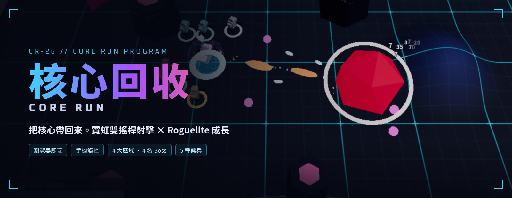</a>

<h1 align="center">核心回收 // CORE RUN</h1>

<b>把核心帶回來。</b>一款在瀏覽器裡就能玩的霓虹風俯視角雙搖桿射擊遊戲，加上 Roguelite 式的局外成長。

  

  
  
  
  
  
  

  <b><a href="https://jinweihuang20.github.io/core-recycle/">▶ 立即遊玩：jinweihuang20.github.io/core-recycle</a></b>
  　｜　<b><a href="https://github.com/jinweihuang20/core-recycle/releases/latest">⬇ 下載 Windows 版</a></b>

  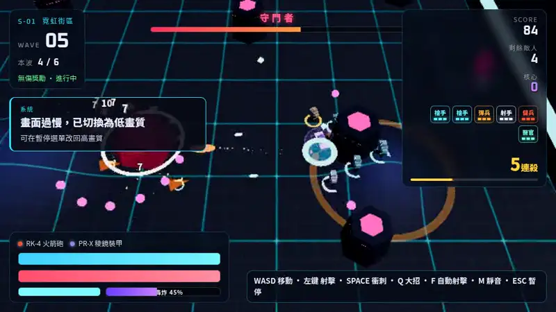
   實機畫面：霓虹街區第 5 波，帶著傭兵小隊迎戰 Boss「守門者」。

---

## 目錄

- [下載與遊玩](#下載與遊玩)
- [遊戲簡介](#遊戲簡介)
- [特色](#特色)
- [操作說明](#操作說明)
- [區域與 Boss](#區域與-boss)
- [傭兵介紹](#傭兵介紹)
- [軍械庫](#軍械庫)
- [攜帶裝置與瀏覽器建議](#攜帶裝置與瀏覽器建議)
- [系統需求](#系統需求)
- [存檔說明](#存檔說明)
- [兌換代碼活動](#兌換代碼活動)
- [更新日誌](#更新日誌)

---

## 下載與遊玩

| 方式 | 說明 |
| --- | --- |
| 🌐 **網頁版** | 直接開 **[jinweihuang20.github.io/core-recycle](https://jinweihuang20.github.io/core-recycle/)**，電腦、手機都能玩，永遠是最新版 |
| 💿 **Windows 安裝版** | 到 **[Releases 最新版](https://github.com/jinweihuang20/core-recycle/releases/latest)** 下載 `CoreRecycle-Setup-x.y.z.exe`。會自動更新，也可以在「設定」裡按 **「檢查更新」** |
| 📦 **Windows 免安裝版** | 同一頁下載 `CoreRecycle-x.y.z-win-portable.zip`，**解壓即玩**，不需要管理員權限，適合放隨身碟 |

- ⚠️ 安裝檔與免安裝版目前**沒有程式碼簽章**，第一次執行時 Windows SmartScreen 可能顯示「Windows 已保護您的電腦」：請按 **「其他資訊」→「仍要執行」**。之後透過自動更新安裝的版本不會再跳出。
- 安裝版啟動時會自動檢查新版本，下載完成後詢問是否立即重新啟動更新；選「稍後」則在關閉遊戲時自動安裝。
- 桌面版存檔放在**使用者資料夾** `%APPDATA%\core-recycle`，不在遊戲資料夾裡；移動、刪除或更新遊戲資料夾都不會掉存檔。桌面版與網頁版的存檔是分開的。
- 桌面版按 **F11** 切換全螢幕。

---

## 遊戲簡介

你是一名回收兵，任務只有一個：**把核心帶回來**。

《核心回收》是一款**俯視角雙搖桿射擊遊戲**。一隻手移動，另一隻手瞄準射擊，在一波接一波湧上來的敵人中活下去。每一局都會在升級時抽到不同的「戰場強化」，組出不一樣的打法。局裡撿到的核心會帶回基地，用來解鎖新武器、新裝甲，僱用並強化傭兵。這就是 **Roguelite 的局外成長**：就算這局倒下了，下一局也會更強。

  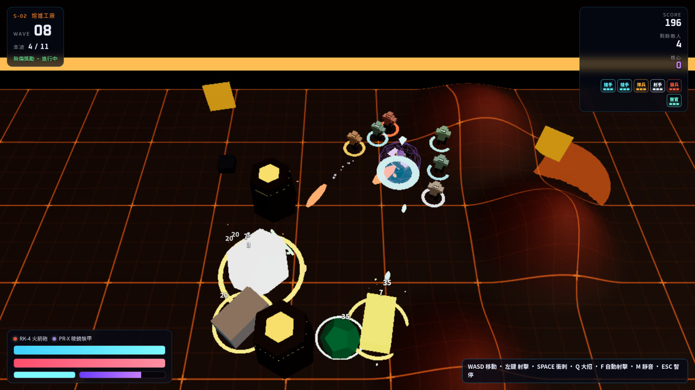
  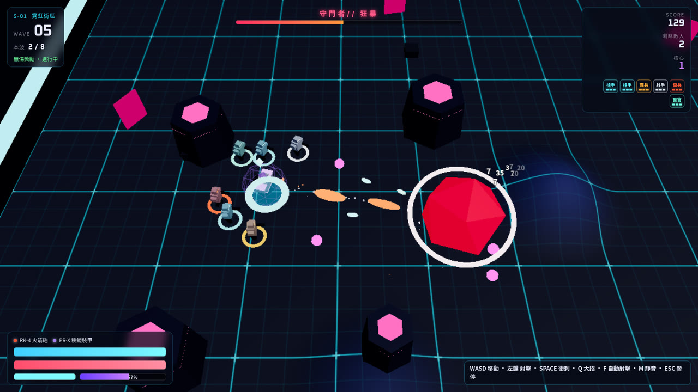

---

## 特色

- 🌊 **波次生存**：每一波敵人越來越多、種類越來越雜。第 3 波起，部分波次會隨機出現特殊事件：
  - **菁英潮**：菁英怪大量出現，掉落加倍。
  - **隕石雨**：看到紅圈立刻閃開。
  - **閃擊戰**：敵人以兩倍速度湧入。
  - **熄燈**：遠處沉進黑暗，只有近處還看得見。
- 💀 **Boss 戰＋動態配樂**：每 5 波一場 Boss 戰，共 10 名 Boss，各有招式。配樂由 WebAudio 即時生成，選單、戰鬥、Boss 戰各有一首。Boss 血量降到一半以下時會「狂暴」，配樂也會跟著加入額外鼓組、變得更激烈。
- 🗺️ **10 個區域・章節選單**：S-01 到 S-10 每區有自己的地圖形狀、柱子配置、地面危害、氛圍與配樂，還有專屬的新敵人與 Boss。出擊選單以「章節」分頁，一章 10 區，不用捲動。
- ♾️ **無盡模式**：打完 S-10 核心王座後（第 51 波起）進入無盡，全部 10 名 Boss 每 5 波輪流登場。
- 💥 **大招**：每把武器都有專屬大招，蓄滿後施放 2–4 秒的爆發並伴隨慢動作。
- 🎲 **戰場強化**：升級時從卡片中挑一張，共 38 種強化，分 普通／稀有／史詩 三種稀有度，包含環繞自身、擋下敵方子彈的 **格擋球**（最多 5 顆）。
- 🤝 **傭兵小隊**：5 種傭兵，最多僱用 12 名，可自由**編隊**決定誰上場。出擊名額從 3 格起，可用核心擴充到 8 格。每一類都能強化 血量／傷害（醫官為治療）／射速，每項最高 Lv 10。在軍械庫裡可以看到傭兵的 **3D 即時預覽**，對著木樁實際開火。
- 🔫 **軍械庫（永久成長）**：8 把武器、7 套裝甲，每把武器可用核心做 **武器強化**（Lv 0–10，每級傷害 +8%、射速 +4%）。另有 8 件遺物，靠達成成就解鎖。滑過武器卡片就能看 3D 試射。
- 🎨 **造型**：9 種機甲塗裝，用核心購買或靠紀錄解鎖，純外觀不影響數值。
- 🏆 **戰績**：記錄最高波數、最高分數、出擊次數、累計擊殺、菁英與 Boss 擊殺數，共 29 項成就（里程碑），達成可領核心。結算畫面有 **傷害分析**，告訴你被什麼打倒、傷害主要來自哪裡。
- 📖 **圖鑑／新情報**：28 種敵人（含 10 名 Boss），遇過才會解鎖情報，新區域的敵人會跳出新情報卡。
- 🎁 **兌換代碼**：主選單可輸入活動兌換代碼領取獎勵。
- 📱 **手機雙搖桿觸控**：左半邊移動、右半邊瞄準並按住射擊，右側有 衝刺／大招／自動／暫停 按鈕。直向、橫向都能玩。
- ⚙️ **畫質設定**：高／低兩段畫質，可顯示 FPS。畫面太卡時會自動切換為低畫質，之後可以在暫停選單改回來。另有全螢幕與靜音，都在「設定」頁。
- 🗺️ **區域進度**：抵達新區域的第一波就會解鎖該區域，之後可以直接從該區域的起始波出擊。

  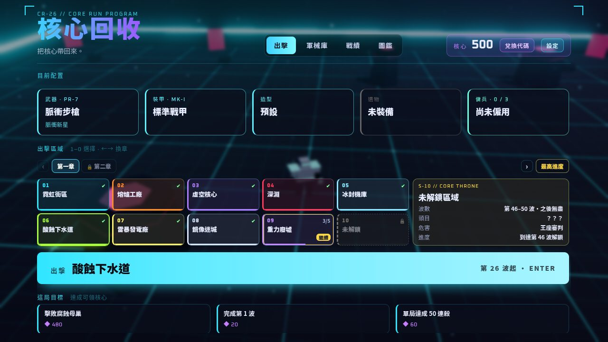
   主選單：目前配置、章節分頁的出擊區域（1–0 鍵選擇、←→ 換章）、本局可達成的目標。

  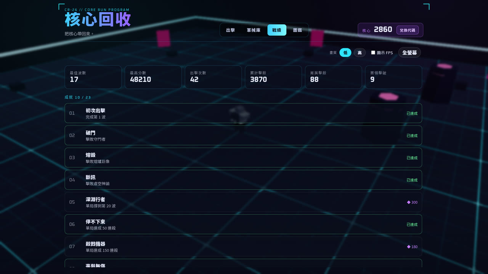
  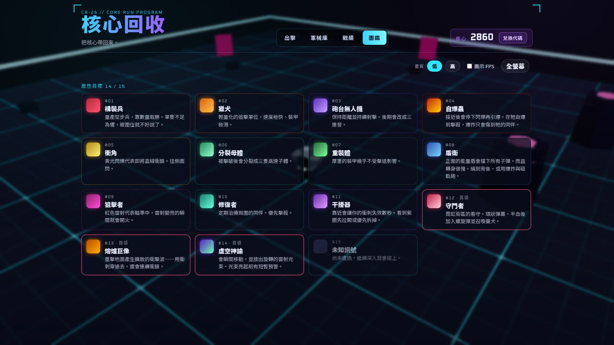

---

## 操作說明

| 動作 | 💻 電腦（鍵盤＋滑鼠） | 📱 手機（觸控） |
| --- | --- | --- |
| 移動 | `W` `A` `S` `D` 或 方向鍵 | 左半邊螢幕：虛擬搖桿 |
| 瞄準／射擊 | 滑鼠瞄準，按住**左鍵**射擊 | 右半邊螢幕：虛擬搖桿，往哪推就往哪打 |
| 衝刺 | `左 Shift` 或 **滑鼠右鍵** | 右側「衝刺」按鈕 |
| 大招 | `Q`（或 `E`），蓄滿後施放 | 右側「大招」按鈕（顯示蓄力百分比，蓄滿後點擊） |
| 自動射擊 | `F` 切換 | 右側「自動」按鈕（自動射擊／鎖定） |
| 暫停 | `Esc` 或 `P` | 右側最上方「暫停」按鈕 |
| 靜音 | `M` | 暫停畫面的「靜音」按鈕 |
| 選擇強化卡 | 點擊卡片，或按 `1` `2` `3` `4` | 點擊卡片 |
| 選出擊區域 | 主選單按 `1`–`0`，`←` `→` 切換章節 | 點擊章節分頁與區域卡片 |
| 軍械庫切換分類 | `Q` / `E` | 點擊分類分頁 |
| 出擊 | 主選單按 `Enter` | 點擊「出擊」 |
| 結算後再來一局 | `Enter` 或 `R` | 點擊「再次出擊」 |

> 💡 小技巧：地面上**青色光環**就是你。看到青色地面帶亮起，代表霓虹閘門即將掃過，往前或往後閃開。衝刺可以穿過 Boss 的衝擊波。

---

## 區域與 Boss

遊戲共 10 個區域（第一章），每區 5 波，第 5 波是 Boss 戰。每一區都有自己的地圖形狀與地面危害。打完 S-10 後從第 51 波起進入**無盡模式**，全部 10 名 Boss 每 5 波依序輪流登場。

| 區域 | 波數 | 區域機制 | Boss（生命） |
| --- | :---: | --- | --- |
| **S-01 霓虹街區** NEON DISTRICT | 1–5 | 霓虹閘門掃過前，地面會先亮起青色帶 | **守門者**（900） |
| **S-02 熔爐工廠** THE FOUNDRY | 6–10 | 地面會噴出熔漿，看到橙圈立刻讓開 | **熔爐巨像**（1500） |
| **S-03 虛空核心** VOID CORE | 11–15 | 重力井把你往中心拉，干擾器會鎖住衝刺 | **虛空神諭**（1200） |
| **S-04 深淵** THE ABYSS | 16–20 | 安全區慢慢收縮，待在圈外會被虛空咬；地塊會崩落 | **深淵巨獸**（2200） |
| **S-05 冰封機庫** FROZEN HANGAR | 21–25 | 地面很滑、衝刺有慣性，冷凍噴口會凍住腳步 | **冰霜巨像**（2600） |
| **S-06 酸蝕下水道** ACID SEWERS | 26–30 | 十字形管道，酸液池會冒出，噴吐者留下腐蝕痕跡 | **腐蝕母巢**（3000） |
| **S-07 雷暴發電廠** STORM PLANT | 31–35 | 環形廠區圍著中央深坑，地板分區輪流通電 | **雷霆核心**（2900） |
| **S-08 鏡像迷城** MIRROR MAZE | 36–40 | 菱形城區，折射光束沿白框掃過 | **幻影**（3100） |
| **S-09 重力廢墟** GRAVITY RUINS | 41–45 | 六角形遺跡，重力井與高重力場拖慢腳步 | **黑洞引擎**（3400） |
| **S-10 核心王座** CORE THRONE | 46–50 | 八角形王座廳，審判區段輪流通電 | **最終核心**（4200，三階段） |

一般敵人：構裝兵、獵犬、砲台無人機、自爆蟲、衝角、分裂母體（會分裂出子體）、重裝體、盾衛、狙擊者、修復者、干擾器，以及後期區域的 霜凍兵、酸液噴吐者、電弧無人機、分身者、牽引者、王座衛兵。

> 💡 干擾器：只有站進它的紫圈（半徑 9）才會被鎖衝刺，被鎖時角色旁會有紫色箭頭指向最近的干擾器，用子彈打掉即可。

  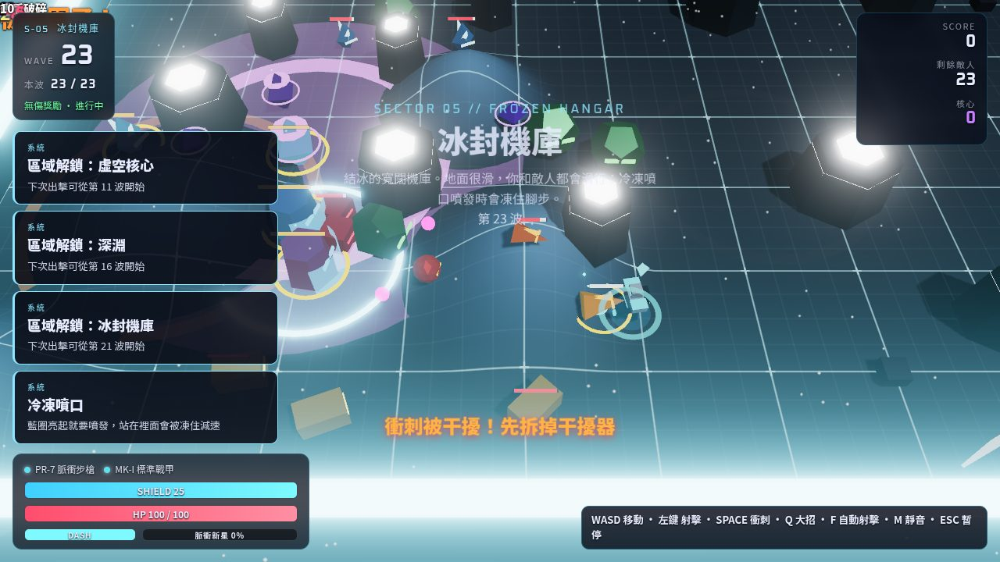
  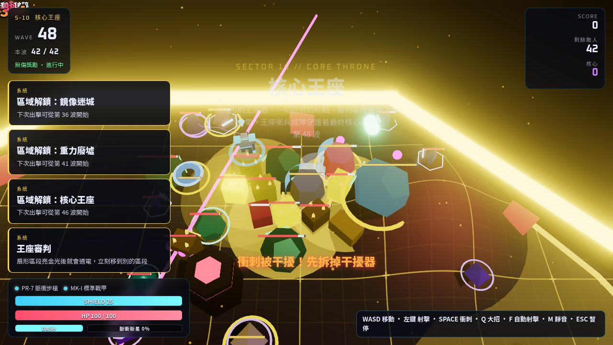
   
  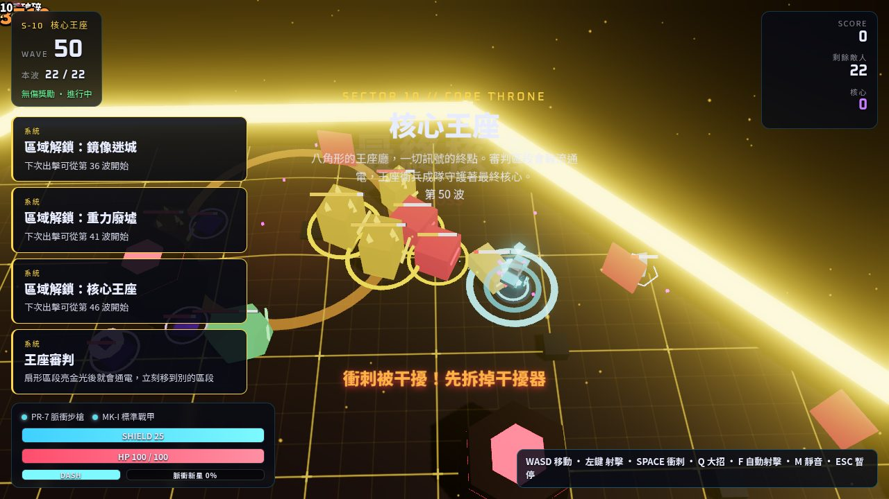
   S-05 冰封機庫、S-10 核心王座，以及最終 Boss「最終核心」。

---

## 傭兵介紹

在軍械庫用核心僱用。同類型可以重複僱用，每多一名價格 ×1.65（四捨五入），總共最多 12 名。在「傭兵」分頁可以**編隊**，選出要上場的成員；出擊名額起始 3 格，可用核心擴充到 8 格（第 4–8 格分別為 ◆ 600／1200／2200／3500／5000）。倒下的傭兵會在下一波站起來。

| 傭兵 | 代號 | 武器 | 首名價格 | 第 2 名 | 特色 |
| --- | --- | --- | :---: | :---: | --- |
| **僱傭槍手** | MG-1 | 脈衝步槍 | ◆ 70 | ◆ 116 | 穩定的單發脈衝，站在側翼補傷害 |
| **破門霰彈兵** | SG-H | 霰彈槍 | ◆ 110 | ◆ 182 | 近距離一次噴出 5 發，貼臉清雜兵 |
| **遠程射手** | RG-H | 磁軌砲 | ◆ 160 | ◆ 264 | 慢、準、穿透，能破盾，優先點掉遠處的盾衛與狙擊者 |
| **火箭傭兵** | RK-H | 火箭砲 | ◆ 160 | ◆ 264 | 慢速火箭，命中後小範圍爆炸，專打堆在一起的敵人 |
| **戰地醫官** | MD-2 | 脈衝手槍 | ◆ 130 | ◆ 215 | 火力很弱，但會緩慢修復你的生命與護盾 |

**傭兵強化**：每一類傭兵都有三條強化，套用到同類型的每一名，每條最高 Lv 10。

| 強化 | 每級效果 |
| --- | --- |
| 血量 | 最大生命 +15% |
| 傷害（醫官為「治療」） | 傷害／治療量 +12% |
| 射速 | 射速 +8% |

  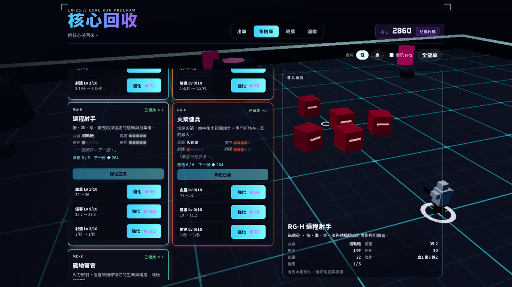
   傭兵卡片：僱用、三條強化，右側是即時 3D 預覽。

---

## 軍械庫

  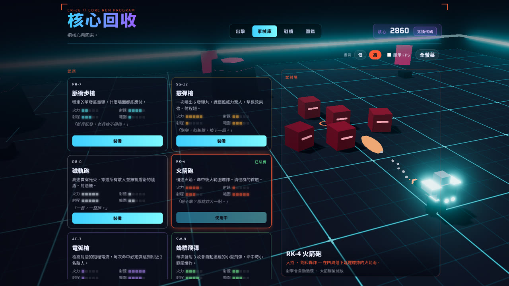
   軍械庫：滑過武器卡片，右邊的試射場就會實際開火並示範大招。

| 武器 | 價格 | 大招 | 說明 |
| --- | :---: | --- | --- |
| 脈衝步槍 | 初始 | 脈衝新星 | 穩定的單發能量彈，什麼場面都能應付 |
| 霰彈槍 | ◆ 150 | 點空白刃 | 一次噴出 6 發彈丸，近距離威力驚人、擊退強，射程短 |
| 磁軌砲 | ◆ 300 | 貫穿軌道 | 高速貫穿光束，穿透所有敵人並無視盾衛的護盾，射速慢 |
| 火箭砲 | ◆ 300 | 飽和轟炸 | 慢速火箭，命中後大範圍爆炸，清怪群首選 |
| 電弧槍 | ◆ 450 | 電弧風暴 | 極高射速的短程電流，每次命中必定彈跳到附近 2 名敵人 |
| 地雷發射器 | ◆ 500 | 飽和雷區 | 在準星位置埋設感應地雷，敵人靠近才爆 |
| 迴力刃 | ◆ 550 | 環刃領域 | 擲出會飛回來的能量刃，途中可反覆割傷敵人 |
| 蜂群飛彈 | ◆ 600 | 蜂群飽和 | 每次發射 3 枚自動追蹤的小型飛彈，命中時小範圍爆炸 |

| 裝甲 | 價格 | 說明 |
| --- | :---: | --- |
| 標準戰甲 | 初始 | 生命 100、護盾 25 |
| 疾風輕甲 | ◆ 150 | 生命 75、護盾 35，移動速度 +18%，衝刺冷卻 -35% |
| 堡壘重甲 | ◆ 250 | 生命 170，受到傷害 -25%，但沒有護盾、移動速度 -12% |
| 稜鏡裝甲 | ◆ 350 | 生命 90、護盾 40，衝刺時把身邊的敵方子彈反彈回去 |
| 復仇裝甲 | ◆ 400 | 生命 120、護盾 15，每次受傷都釋放衝擊波 |
| 虹吸戰甲 | ◆ 450 | 生命 95、護盾 20，擊殺回復 10 護盾（可超過上限到 160%） |
| 相位裝甲 | ◆ 500 | 生命 85、護盾 30，衝刺後 0.8 秒無敵，下一輪射擊必定爆擊 |

**遺物**（8 件，達成成就解鎖）：守門者之眼、熔渣核心、虛空碎片、殺戮印記、幽靈協議、深淵符印、軍火特權、拾荒磁環。

---

## 攜帶裝置與瀏覽器建議

<table>
  <tr>
    <th>手機直向</th>
    <th>手機直向・戰鬥</th>
  </tr>
  <tr>
    <td align="center">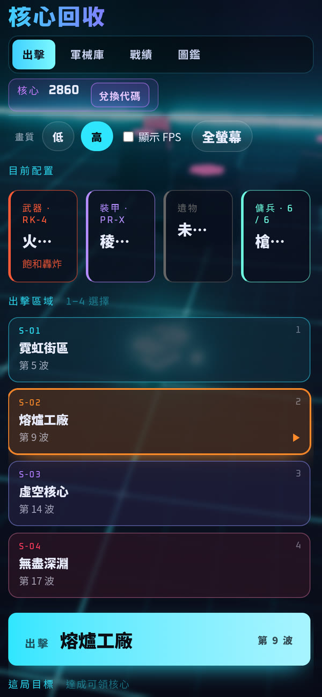</td>
    <td align="center">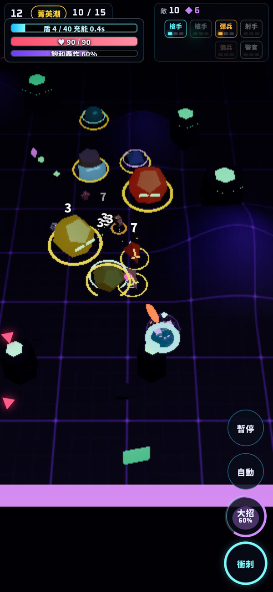</td>
  </tr>
</table>

<table>
  <tr>
    <th>手機橫向</th>
    <th>手機橫向・戰鬥</th>
  </tr>
  <tr>
    <td align="center">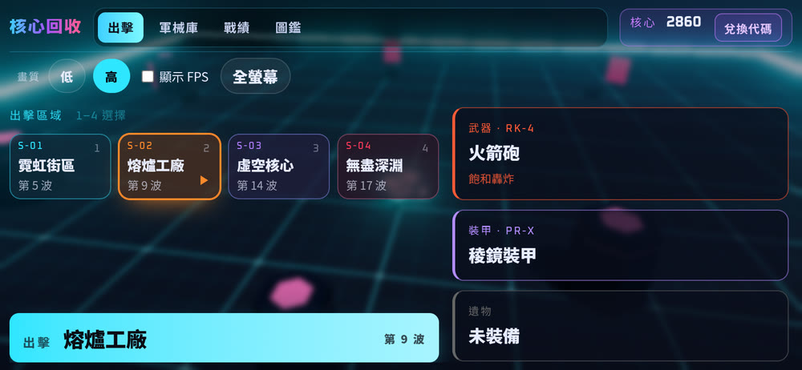</td>
    <td align="center">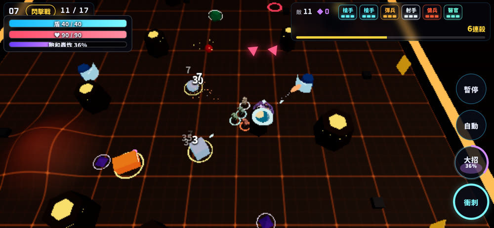</td>
  </tr>
</table>

- **電腦**：用鍵盤＋滑鼠遊玩，建議使用最新版的 Chrome、Edge、Firefox 或 Safari（需要支援 WebGL）。
- **手機／平板**：會自動切換成雙搖桿觸控操作。**建議橫向遊玩**，視野更廣，敵人比較不會從畫面外靠近；直向也能打，相機會再拉遠一點。
- **加入主畫面**：在手機瀏覽器選「加入主畫面」，就能像 App 一樣全螢幕開啟。
- **跑不順？** 在選單或暫停畫面把畫質切到「低」，或打開「顯示 FPS」確認流暢度。遊戲偵測到畫面過慢時也會自動切換為低畫質。

---

## 系統需求

- **Windows 桌面版**：Windows 10／11（64 位元，x64）。
- **網頁版**：支援 WebGL 的新版 Chrome、Edge、Firefox 或 Safari；手機與平板也可以玩。

---

## 存檔說明

- 網頁版進度**自動存在你目前使用的瀏覽器裡**（localStorage）；桌面版存在使用者資料夾（見上方下載說明），不需要註冊帳號，也不會上傳到任何伺服器。
- 存的內容包含：核心、已解鎖的武器／裝甲／遺物、傭兵、編隊與強化等級、造型、已開放的區域與各區域最遠到達的波數紀錄、最高紀錄、成就、圖鑑，以及兌換過的代碼。畫質、FPS 顯示、靜音等設定也一併保存。
- 存檔**綁定在這台裝置的這個瀏覽器**：換手機、換瀏覽器，或使用無痕模式，都會是新的存檔。
- ⚠️ **清除瀏覽器資料（網站資料／Cookie）會把存檔一起清掉**，且無法復原。

---

## 兌換代碼活動

不定期會舉辦活動、發放兌換代碼，可以領取核心等獎勵。

**兌換方式**

1. 打開遊戲，在主選單的「核心」數字旁，點 **「兌換代碼」**。
2. 輸入代碼（不分大小寫），按 **「兌換」** 或 Enter。
3. 兌換成功後，獎勵會立刻加到你的核心餘額並自動存檔。

**注意事項**

- 每組代碼在同一份存檔只能兌換一次。
- 部分代碼有活動期間，期間外兌換會顯示「活動尚未開始」或「活動已結束」。
- 代碼請留意官方活動公告。

---

## 更新日誌

### 桌面版

| 版本 | 內容 |
| --- | --- |
| **v1.0.4** | 新增 **免安裝版** `win-portable.zip`，與安裝版一起發佈 |
| **v1.0.3** | 電腦版主選單依視窗高度自動縮放、不再出現捲軸；設定頁新增 **「檢查更新」** 與版本號 |
| **v1.0.2** | 新增 **S-05～S-10** 六個區域、新敵人與 Boss、無盡模式 Boss 輪替；**章節分頁** 區域選單；每區獨特的地圖形狀、危害與氛圍；**傭兵編隊** 與核心擴充名額；干擾器只在紫圈內鎖衝刺並顯示方向箭頭；深淵縮圈傷害與 Boss 登場標題重疊修正；HUD 狀態條文字修正 |
| **v1.0.1** | 大招改版（2–4 秒爆發、慢動作）與平衡；**格擋球** 強化；結算 **傷害分析**；**武器強化**；**造型**；軍械庫分類分頁；設定頁；Boss 不再卡柱子；手機通知與 Boss 血條排版；電腦版大螢幕選單 |
| v1.0.0 | 第一個 Windows 桌面版（安裝版＋自動更新） |

### 網頁版早期更新

| 日期 | 內容 |
| --- | --- |
| 2026-10-29 | 移除**區域接關**：每次出擊都從該區域的起始波開始（避免直接跳進菁英／守門者波、身上沒有任何戰場強化）；出擊按鈕改顯示起始波與該區最遠紀錄 |
| 2026-10-29 | 新增 **兌換代碼** 系統；手機版隱藏選單左上、右上的裝飾直角框，不再擋住標題 |
| 2026-10-29 | 新增 **傭兵強化**（血量／傷害／射速）與軍械庫 **3D 傭兵預覽** |
| 2026-10-29 | 新增 **可僱用傭兵**，以及程序化生成的 **Boss 戰配樂** |
| 2026-10-29 | 手機 HUD 改版：生命、護盾、大招蓄力更清楚；修正手機橫向選單 |
| 2026-10-29 | 新增 **手機雙搖桿觸控** 與手機友善介面 |
| 2026-10-29 | 各區域從上次到達的波數接續出擊；遊戲定名為《核心回收》 |
| 2026-10-28 | 首局體驗優化，讓新手更容易看懂戰場 |

---

  <a href="https://jinweihuang20.github.io/core-recycle/"><b>▶ 立即遊玩《核心回收》</b></a>
   
  本倉庫只存放遊戲發佈用的網頁檔案，由自動部署更新。

